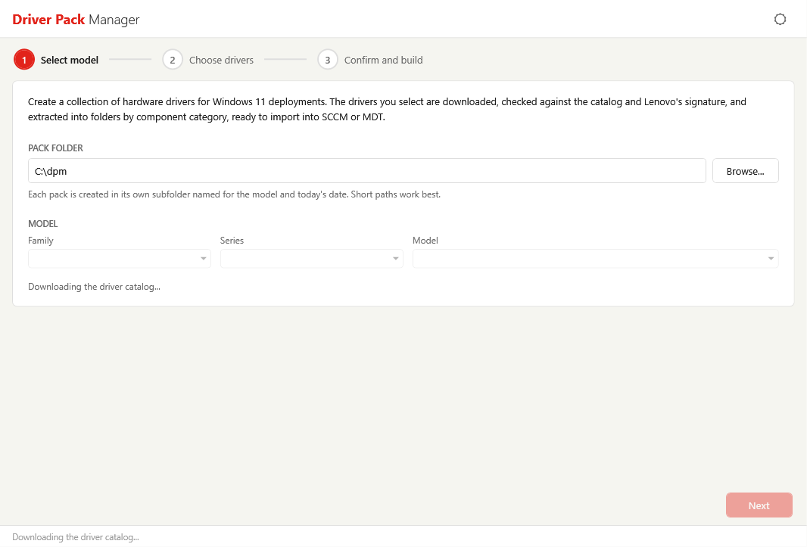
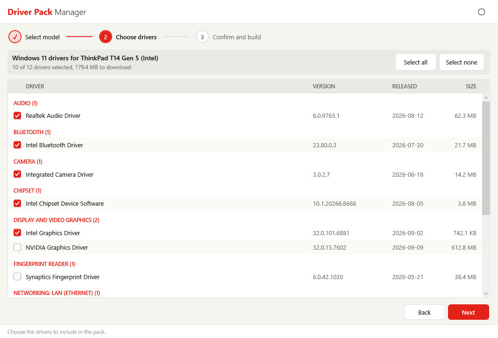
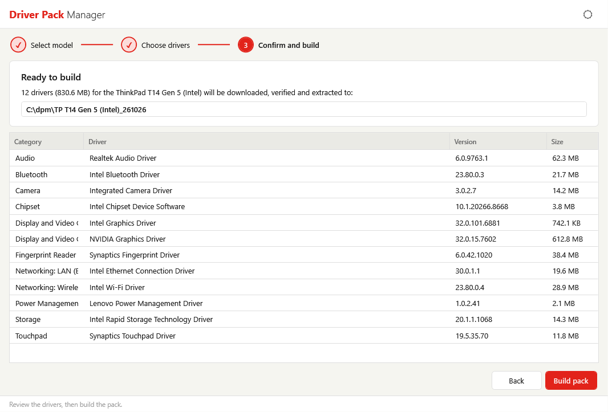
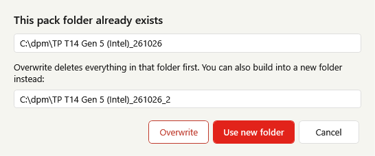
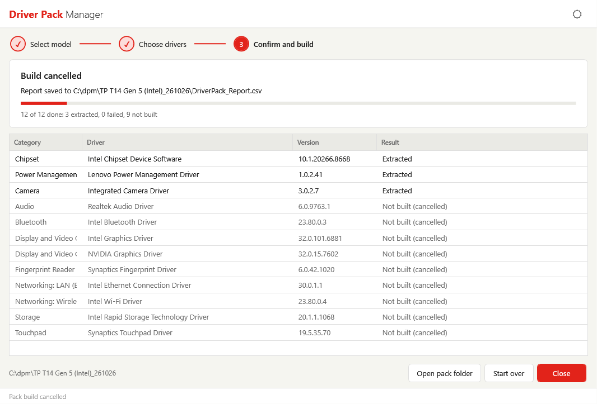
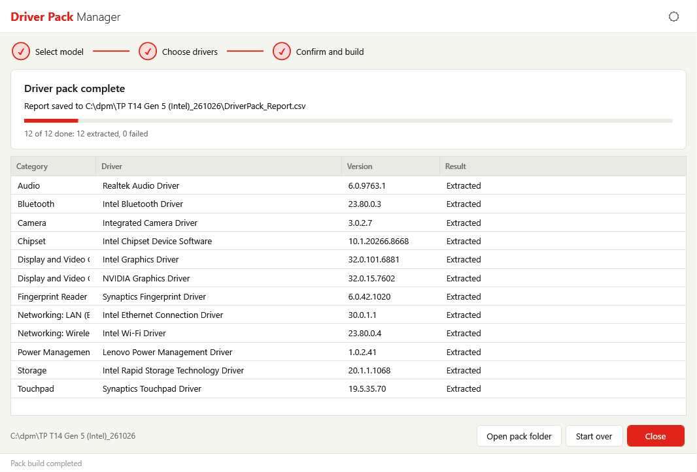
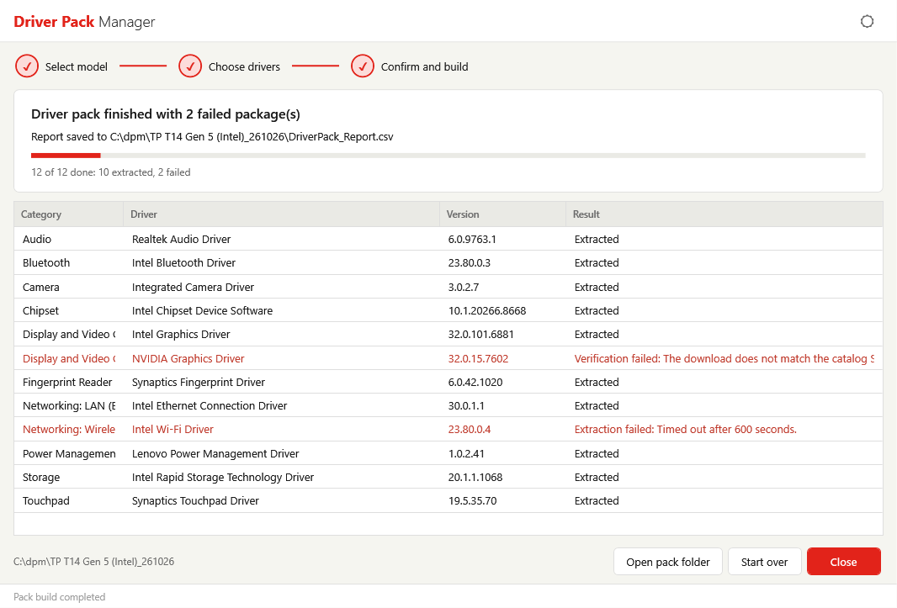
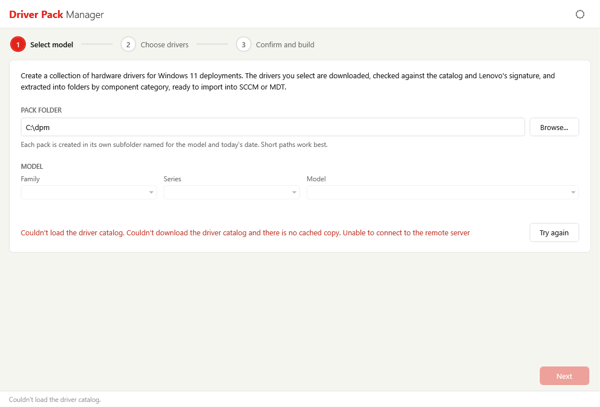

# Driver Pack Manager

Driver Pack Manager is a WPF graphical wizard that builds driver packs for Lenovo commercial PCs running Windows 11. It downloads the Lenovo driver catalog, lets you pick a model by family, series, and name, and lists the Windows 11 drivers Lenovo currently offers for it. The drivers you select are downloaded, verified, and silently extracted into one folder per component category, ready to import into Microsoft Configuration Manager (SCCM) or MDT.

The tool ships as a single PowerShell script (`DriverPackManager.ps1`).
<!-- TODO: Add the download link (or Install-Script command) for DriverPackManager.ps1. The script does not state where customers get it. -->

## Overview

Each driver in a pack goes through the same sequence:

1. **Download** from Lenovo. Up to three packages download at the same time.
2. **Verify** the download against the SHA256 checksum published in the Lenovo driver catalog and confirm it carries a valid Lenovo digital signature.
3. **Extract** the package silently, without installing anything on the computer running the tool.
4. **Clean up** by deleting the package executable after extraction to save disk space.

When the build finishes, a CSV report listing every selected driver and its result is written to the root of the pack folder.

The catalog itself is also verified. The tool only accepts a catalog that carries a valid Lenovo signature, and shows that confirmation on the first screen.

## Requirements

- Windows with a desktop session (the tool is a graphical application). The packs it builds are for Windows 11.
- Windows PowerShell 5.1 or PowerShell 7
- Local administrator rights. The tool needs them so packages extract without a UAC prompt for each one. If you start it without them, it asks for elevation and relaunches itself.
- Internet access to Lenovo download servers (`download.lenovo.com`) over HTTPS. The tool uses your system proxy settings with your current Windows credentials.
- Free disk space for the drivers you select. The driver selection page shows the total download size for your selection.

!!! note "Offline use"
    The tool keeps a verified copy of the last catalog it downloaded. If the Lenovo catalog can't be reached, it falls back to that copy and shows a warning with its date. Driver packages can't be downloaded without internet access.

## Launch Driver Pack Manager

Run the script from a PowerShell session:

```powershell
.\DriverPackManager.ps1
```



If the session is not elevated, a UAC prompt appears and the tool relaunches itself with administrator rights. Approve the prompt to continue.

!!! warning "Execution policy is not bypassed"
    The relaunch keeps the PowerShell execution policy your session was using, so a policy that blocks scripts must be resolved before the tool will start.

The tool runs from a protected copy of the script stored in `%ProgramData%\DriverPackManager`, which only administrators can change. The same folder holds the catalog cache and temporary download files.

---

## Interface Overview

The window has four areas: the header bar at the top, the wizard content in the center, the wizard buttons below it, and a status bar at the bottom.

- **Header bar** - Shows the application name and a **theme toggle** (sun/moon icon) that switches between light and dark themes. The tool detects the Windows light/dark preference at launch and applies the matching theme.
- **Step indicator** - Shows the three wizard steps: **Select model**, **Choose drivers**, and **Confirm and build**. Completed steps show a check mark.
- **Wizard buttons** - **Back** and **Next** move between steps. On the last step, **Next** becomes **Build pack**.
- **Status bar** - Shows the current activity or the next action to take.


---

## Walkthrough

### Step 1: Select a Model

When the tool opens, it downloads the Lenovo driver catalog. The status bar shows **Downloading the driver catalog...** until it finishes. Once loaded, the page reports the number of models that have Windows 11 drivers, and whether the catalog was downloaded or loaded from the cache, along with its date and time.

#### Choose the Pack Folder

The **Pack Folder** box sets where driver packs are created. The default is `C:\dpm`. Click **Browse...** to choose another folder.

- Enter a full local path (for example, `C:\dpm`) or a UNC path (for example, `\\server\share\drivers`). Relative paths are not accepted, and **Next** stays unavailable until the path is valid.
- Each pack is created in its own subfolder named for the model and today's date. See [Driver Pack Folder Structure](#driver-pack-folder-structure).

!!! warning "Keep the pack path short"
    Some drivers have deep folder structures, and Windows limits paths to 260 characters. The default `C:\dpm` is recommended for this reason.

#### Choose the Model

Select the model in three steps, using the **Family**, **Series**, and **Model** dropdowns. Each dropdown becomes available after the one before it is chosen, and a dropdown with only one choice selects it automatically.

After you pick a model, the page shows the exact folder the pack will be created in.


!!! note "Models that are not listed"
    Only models that have a Windows 11 driver list in the catalog are shown. ThinkCentre X AIO and X Tower models are not offered by this tool.

Click **Next** to continue.

### Step 2: Choose Drivers

The page lists every Windows 11 driver Lenovo offers for the selected model, grouped by component category.


Each row shows:

| Column | Description |
| --- | --- |
| Driver | Driver title. Hover over the row to see the package name. |
| Version | Driver version |
| Released | Release date |
| Size | Download size |

All drivers are selected by default. The toolbar at the top of the page shows how many drivers are selected and the total size to download, for example `12 of 12 drivers selected, 812.4 MB to download`.

- Clear the check box next to a driver to leave it out of the pack.
- Click **Select all** or **Select none** to change every driver at once.



**Next** is available when at least one driver is selected.

!!! note "Drivers the catalog has no details for"
    If the catalog lists a driver for the model but has no details for it, the tool can't include it. The summary shows how many drivers are affected.

### Step 3: Confirm and Build

The confirmation page summarizes what will be built: the number of drivers, the total download size, the model, and the full pack folder path. The table below the summary lists each selected driver with its category, title, version, and size.



The page can show warnings in red:

- **Long path** - The pack path is longer than 100 characters. Some drivers may fail to extract under a long path. Go back and choose a shorter pack folder.
- **Folder already exists** - A pack for this model and date already exists. You are asked what to do when you start the build.
- **Folder permissions** - Users who are not administrators can change the contents of the pack folder, so they could alter the pack before it is imported. Restrict that folder to administrators or choose another one.


Review the list. Click **Back** to change the selection, or click **Build pack** to start.

#### If the Pack Folder Already Exists

A pack folder named for the model and date already exists if you built the same model earlier the same day. A dialog offers three choices:

- **Overwrite** - Deletes everything in the existing folder and builds a new pack in its place.
- **Use new folder** - Builds into a new folder with a numeric suffix (`_2`, `_3`, and so on). The dialog shows the name that will be used.
- **Cancel** - Returns to the confirmation page without building.



### Step 4: Download and Extract

The build page shows progress while the pack is created:

- The current activity, such as `Downloading 3 package(s), 2 of 12 done`, `Verifying <driver>`, or `Extracting <driver>`
- A progress bar
- A running count, such as `5 of 12 done: 5 extracted, 0 failed`
- A results table with the category, driver, version, and result for each driver as it completes


Packages download up to three at a time, but they are verified and extracted one at a time. Failed rows are shown in red. Hover over a row to see the full result message.

!!! note "Ten-minute extraction limit"
    A package that does not finish extracting within ten minutes is stopped and recorded as failed.

#### Cancel a Build

Click **Cancel build** to stop. Downloads in progress are cancelled, but the package that is currently being extracted must finish first, so the status bar shows **Cancelling after the current package finishes...**. Drivers that were not built are recorded as **Not built (cancelled)**. Everything already extracted stays in the pack folder, and the CSV report is still written.

If you close the window during a build, the tool asks whether to cancel the build and close when the current package finishes.



#### When the Build Finishes

The title changes to **Driver pack complete**, **Driver pack finished with N failed package(s)**, or **Build cancelled**, and the page shows where the report was saved. Three buttons appear:

- **Open pack folder** - Opens the pack folder in File Explorer
- **Start over** - Returns to the first step to build another pack
- **Close** - Closes the tool



If any package fails, failed rows are shown in red with the reason in the **Result** column.



---

## Driver Pack Folder Structure

Each pack is created with this structure:

``` text
<Pack folder>\<Short model name>_<yyMMdd>\<Category>\<Package ID>\
```

- **Pack folder** - The folder you chose in Step 1 (default `C:\dpm`)
- **Short model name** - The model name with ThinkPad, ThinkCentre, and ThinkStation shortened to **TP**, **TC**, and **TS** at the start of the name, to keep paths short. Characters Windows doesn't allow in folder names are replaced with a dash.
- **yyMMdd** - The date the pack was built (for example, `261026` for October 26, 2026)
- **Category** - The driver's component category from the Lenovo catalog
- **Package ID** - The Lenovo package identifier for the driver. Each package is extracted into its own folder, so drivers never overwrite each other.

An example of a finished pack. Category and package names come from the catalog and vary by model:
<!-- TODO: Replace the <Category> and <Package ID> placeholders with real category names and package IDs from an actual build. -->

``` text
C:\dpm\
`-- TP T14 Gen 5 (Intel)_261026\
    |-- DriverPack_Report.csv
    |-- <Category A>\
    |   `-- <Package ID>\
    |-- <Category B>\
    |   |-- <Package ID>\
    |   `-- <Package ID>\
    `-- <Category C>\
        `-- <Package ID>\
```

Failed packages leave no partial or empty folders behind.

### Pack Report

`DriverPack_Report.csv` is written to the root of the model folder after every build, including cancelled builds. It has one row for every driver you selected, in the order they were listed, with these columns:

| Column | Description |
| --- | --- |
| Title | Driver title |
| Version | Driver version |
| Category | Component category |
| PackageID | Lenovo package identifier |
| Released | Release date |
| Size | Download size |
| Status | `Extracted`, the reason the driver failed, or `Not built (cancelled)` |
| SourceURL | Lenovo download address for the package |

### Import the Pack into SCCM

<!-- TODO: Expand with real Configuration Manager steps (Import Driver wizard, driver package creation, boot image/task sequence use). The script contains no import steps. -->
After the build, import the drivers from the pack folder using the Configuration Manager console. For packs built on a local drive, copy the model folder to a network share the site server can read, or build directly to a UNC path in Step 1. Then point the import at the category folders, or at a single package folder to import one driver at a time.

Packs built on a local drive are restricted so that only administrators can change them, and standard users can read them. Packs built to a network share keep the permissions set on that share, so make sure only trusted administrators can write to it.

---

## Security Checks

Driver Pack Manager protects the drivers on their way from Lenovo to your deployment tools:

- **Signed catalog** - The catalog must carry a valid Lenovo signature. A catalog that fails the check is rejected.
- **Checksum and signature on every package** - A package is extracted only if its SHA256 checksum matches the catalog and it carries a valid Lenovo digital signature.
- **Protected work folders** - Downloads and extraction use a work folder under `%ProgramData%\DriverPackManager` that only administrators can write to. The work folder is deleted when the build ends.
- **Protected pack folders** - Packs built on a local drive are locked to administrators (read access for users) so nobody can change the drivers before they are imported.
- **No links** - The tool refuses to build into a folder that is a junction or symbolic link.

---

## Troubleshooting

### The tool doesn't open after the UAC prompt

The tool needs administrator rights to run. If the elevation prompt is cancelled or fails, an error is shown and the tool does not start. Run the script again and approve the prompt, or start it from an elevated PowerShell session.

If PowerShell reports that running scripts is disabled, review your execution policy, or unblock the downloaded file:

```powershell
Unblock-File -Path .\DriverPackManager.ps1
```

### "Couldn't load the driver catalog"

The tool couldn't download the catalog and has no cached copy to use. Check that the computer can reach `download.lenovo.com` over HTTPS, and that any proxy allows your current Windows credentials. Click **Try again** to retry.



### A warning says the cached catalog is being used

The latest catalog could not be downloaded, so the tool is using the last verified copy and shows its date. The driver list may be out of date. Resolve the network problem and click **Try again** (if shown) or restart the tool to get the current catalog.


### The catalog failed signature verification

The catalog download was not signed by Lenovo or was altered, and the tool rejected it. Retry from a different network. If the message persists, check whether a proxy or security product is modifying downloads from Lenovo.

### Next is not available on the first page

Check that:

- The catalog finished loading
- A model is selected in the **Model** dropdown
- The pack folder is a full local path (such as `C:\dpm`) or a UNC path (such as `\\server\share`)

### My model isn't in the list

Only models that have Windows 11 drivers in the catalog are listed, and ThinkCentre X AIO and X Tower models are not offered. Check the **Family** and **Series** selections, since models are grouped under them.

### A driver shows "Download failed"

The download couldn't start or finish. Check network access and proxy settings, then build the pack again. Only drivers that failed need to be rebuilt, but the tool builds the full selection, so clear the check boxes for drivers that already succeeded.

### A driver shows "Verification failed"

The package did not pass its checks, and was not extracted. The result states the reason:

- **The download does not match the catalog SHA256 checksum** - The file was damaged or altered in transit. Build again.
- **The package signature is not valid** or **not signed by Lenovo** - The package is not trusted. Don't use it. If the problem repeats, check whether a proxy or security product is modifying downloads.
- **The catalog has no SHA256 checksum for this package** - The package can't be verified, so it is not extracted.

### A driver shows "Extraction failed"

The package was downloaded and verified but could not be extracted. The message gives the cause:

- **Timed out after 600 seconds** - The package took longer than ten minutes. Build again, and check whether security software is scanning or slowing the extraction.
- **The package exited with code N** - The extraction ended with an error. Build again.
- **The package finished but extracted no files** - The package was empty.

### A driver shows "the path is too long"

Windows limits paths to 260 characters, and some drivers have deep folder structures. Go back to Step 1 and choose a shorter pack folder, such as `C:\dpm`.

### The tool says a folder is a junction or symbolic link

The tool will not build into a link, because the files could end up somewhere else. Remove the link or choose another folder.

### A warning says non-administrators can change the pack folder

Standard users have write access to the folder that holds your packs, so they could alter a pack before it is imported. Restrict the folder so only administrators can write to it, or choose another folder.

### I cancelled a build and it kept running

The tool can't interrupt a package while it is being extracted, so it waits for the current package to finish before stopping. Downloads that are still in progress are cancelled right away. The drivers that were already extracted remain in the pack folder.

---

## See Also

<!-- TODO: Confirm the TVRM link is wanted here, and add any other related links (blog post, Lenovo support pages). -->
- [ThinkVantage Repository Manager](../tvrm/index.md)

!!! question "Need Help?"
    Have questions? Visit the [Enterprise Client Management Forum](https://forums.lenovo.com/t5/Enterprise-Client-Management/bd-p/sa01_eg).
