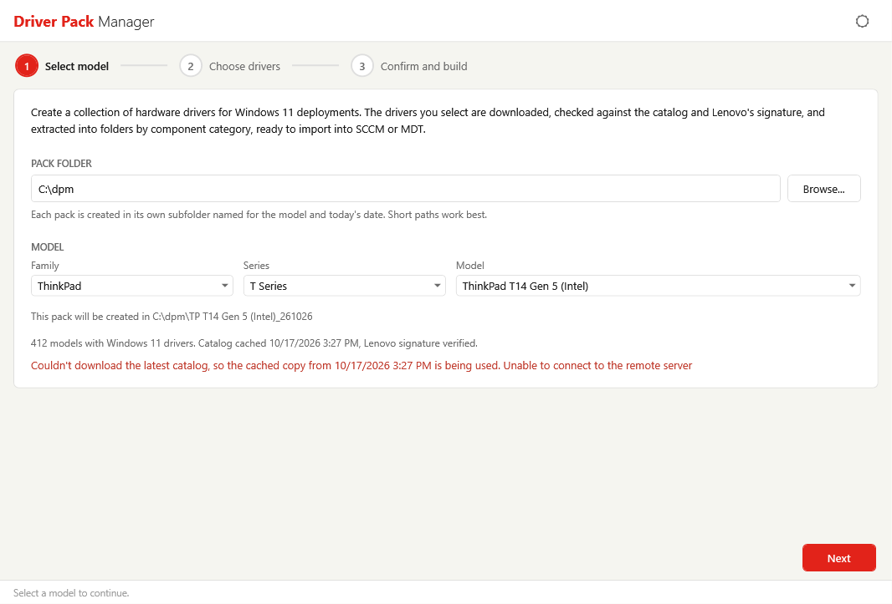

# Troubleshooting

Select a problem to see the cause and the fix.

??? failure "The tool doesn't open after the UAC prompt"
    The tool needs administrator rights to run. If the elevation prompt is cancelled or fails, an error is shown and the tool does not start. Run the script again and approve the prompt, or start it from an elevated PowerShell session. If the message says the script file changed after it was started, the file was modified before the tool could run as administrator. Run it again from a folder that only trusted users can write to.

    If PowerShell reports that running scripts is disabled, review your execution policy, or unblock the downloaded file:

    ```powershell
    Unblock-File -Path .\DriverPackManager.ps1
    ```

??? failure "Couldn't load the driver catalog"
    The tool couldn't download the catalog and has no cached copy to use. Check that the computer can reach `download.lenovo.com` over HTTPS, and that any proxy allows your current Windows credentials. Click **Try again** to retry.

    

??? failure "A warning says the cached catalog is being used"
    The latest catalog could not be downloaded, so the tool is using the last verified copy and shows its date. The driver list may be out of date. Resolve the network problem and restart the tool to get the current catalog.

    

??? failure "The catalog failed signature verification"
    The catalog download was not signed by Lenovo or was altered, and the tool rejected it. The message **The downloaded catalog failed signature verification** appears inside the cached-catalog warning, or inside the **Couldn't load the driver catalog** error if there is no cached copy. If the cached copy itself fails verification, the error says so. Click **Try again** or retry from a different network. If the message persists, check whether a proxy or security product is modifying downloads from Lenovo.

??? failure "Next is not available on the first page"
    Check that:

    - The catalog finished loading
    - A model is selected in the **Model** dropdown
    - The pack folder is a full local path (such as `C:\dpm`) or a UNC path (such as `\\server\share`)

??? failure "My model isn't in the list"
    Only models that have Windows 11 drivers in the catalog are listed, and ThinkCentre X AIO and X Tower models are not offered. Check the **Family** and **Series** selections, since models are grouped under them.

??? failure "A driver shows 'Download failed'"
    The download couldn't start or finish. Check network access and proxy settings, then build the pack again.

    !!! warning "Rebuilding into the same folder"
        Building the same model again on the same day finds the existing pack folder. **Overwrite** deletes everything in it, including drivers that already extracted. To keep them, choose **Use new folder** and clear the check boxes for drivers that already succeeded, then copy the new driver folders into the original pack.

??? failure "A driver shows 'Verification failed'"
    The package did not pass its checks, and was not extracted. The result states the reason:

    - **The download does not match the catalog SHA256 checksum** - The file was damaged or altered in transit. Build again.
    - **The package signature is not valid** or **not signed by Lenovo** - The package is not trusted. Don't use it. If the problem repeats, check whether a proxy or security product is modifying downloads.
    - **The catalog has no SHA256 checksum for this package** - The package can't be verified, so it is not extracted.

??? failure "A driver shows 'Extraction failed'"
    The package was downloaded and verified but could not be extracted. The message gives the cause:

    - **Timed out after 600 seconds** - The package took longer than ten minutes. Build again, and check whether security software is scanning or slowing the extraction.
    - **The package exited with code N** - The extraction ended with an error. Build again.
    - **The package finished but extracted no files** - The package was empty.

??? failure "A driver shows 'the path is too long'"
    Windows limits paths to 260 characters, and some drivers have deep folder structures. Go back to [Step 1](walkthrough.md#step-1-select-a-model) and choose a shorter pack folder, such as `C:\dpm`.

??? failure "The tool says a folder is a junction or symbolic link"
    The tool will not build into a link, because the files could end up somewhere else. Remove the link or choose another folder.

??? failure "A warning says non-administrators can change the pack folder"
    Standard users have write access to the folder that holds your packs, so they could alter a pack before it is used. Restrict the folder so only administrators can write to it, or choose another folder.

??? failure "A driver shows another 'Failed' message"
    The result after **Failed:** gives the reason, such as access denied or not enough disk space. Fix the cause, then build the pack again. Hover over the row to read the full message.

??? failure "The build stopped with an error"
    The build could not start or was interrupted before it finished, so no report is written. The page shows the error. Common causes are a pack folder that can't be created or written to, and a pack folder that is a junction or symbolic link. Choose another folder with **Start over**, or fix the problem the message describes.

??? failure "I cancelled a build and it kept running"
    The tool can't interrupt a package while it is being extracted, so it waits for the current package to finish before stopping. Downloads that are still in progress are cancelled right away. The drivers that were already extracted remain in the pack folder.

