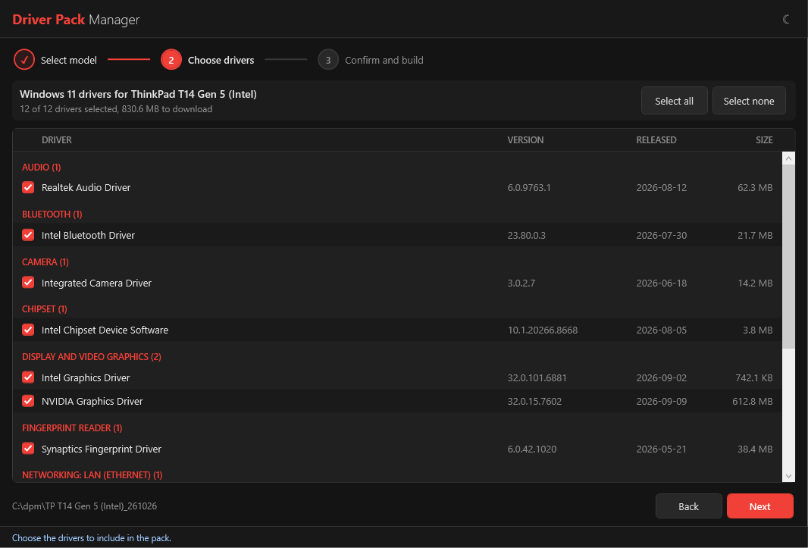
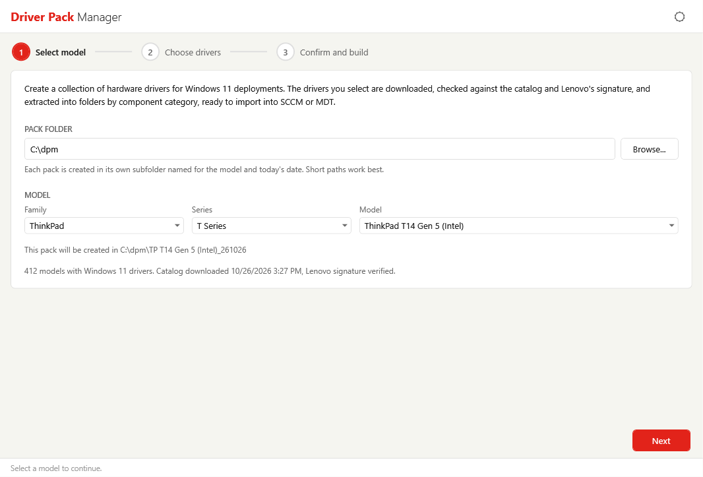
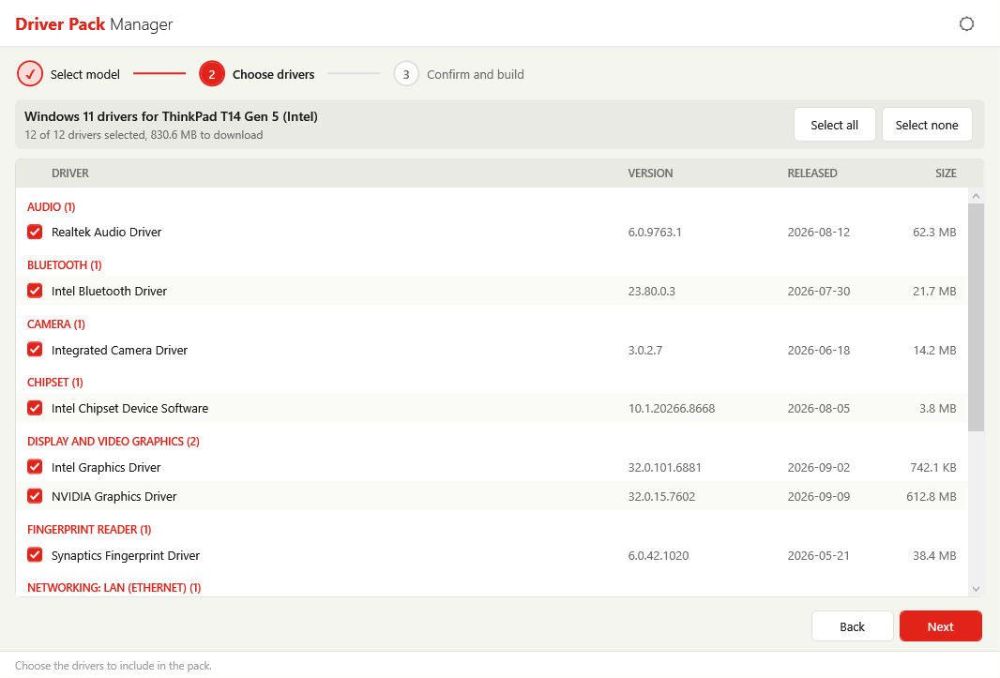
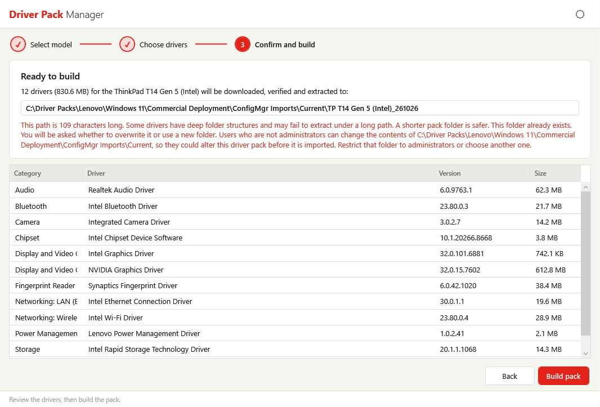
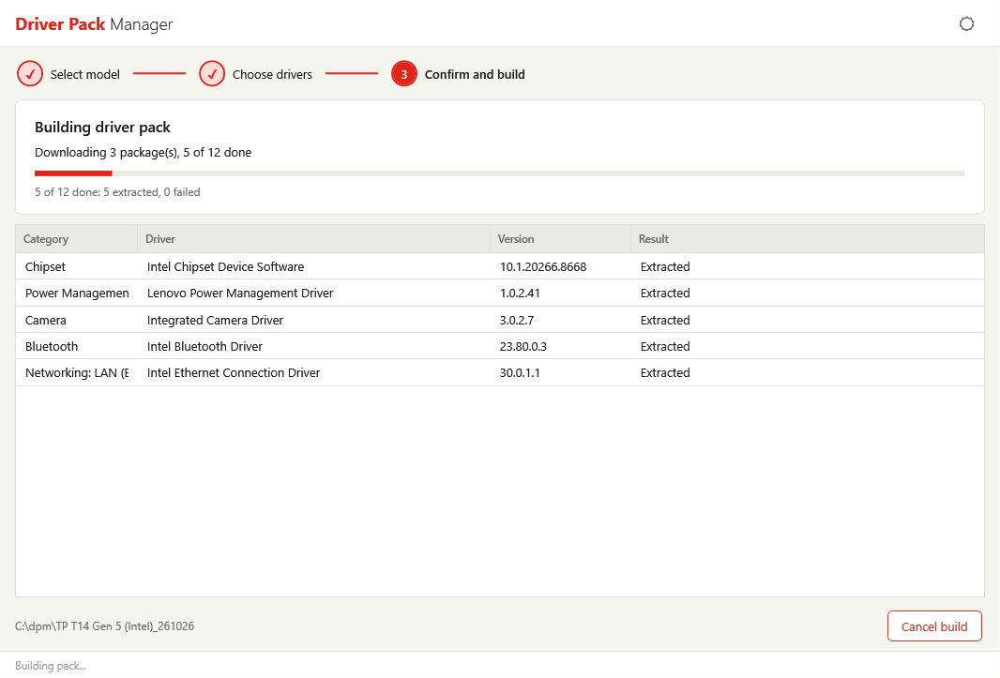

# Walkthrough

This page follows the Driver Pack Manager wizard from start to finish and then describes the pack it creates. To start the tool, see [Launch Driver Pack Manager](index.md#launch-driver-pack-manager).

## Interface Overview

The window has four areas: the header bar at the top, the wizard content in the center, the wizard buttons below it, and a status bar at the bottom.

- **Header bar** - Shows the application name and a **theme toggle** (sun/moon icon) that switches between light and dark themes. The tool detects the Windows light/dark preference at launch and applies the matching theme.
- **Step indicator** - Shows the three wizard steps: **Select model**, **Choose drivers**, and **Confirm and build**. Completed steps show a check mark.
- **Wizard buttons** - **Back** and **Next** move between steps. On the last step, **Next** becomes **Build pack**. While a pack is building and after it finishes, the pack folder path is shown to the left of the buttons.
- **Status bar** - Shows the current activity or the next action to take.



## Step 1: Select a Model

When the tool opens, it downloads the Lenovo driver catalog. The status bar shows **Downloading the driver catalog...** until it finishes. Once loaded, the page reports the number of models that have Windows 11 drivers, and whether the catalog was downloaded or loaded from the cache, along with its date and time.

### Choose the Pack Folder

The **Pack Folder** box sets where driver packs are created. The default is `C:\dpm`. Click **Browse...** to choose another folder.

- Enter a full local path (for example, `C:\dpm`) or a UNC path (for example, `\\server\share\drivers`). Relative paths are not accepted, and **Next** stays unavailable until the path is valid.
- Each pack is created in its own subfolder named for the model and today's date. See [Folder Structure](#folder-structure).

!!! warning "Keep the pack path short"
    Some drivers have deep folder structures, and Windows limits paths to 260 characters. The default `C:\dpm` is recommended for this reason.

### Choose the Model

Select the model in three steps, using the **Family**, **Series**, and **Model** dropdowns. Each dropdown becomes available after the one before it is chosen, and a dropdown with only one choice selects it automatically.

After you pick a model, the page shows the exact folder the pack will be created in.



!!! note "Models that are not listed"
    Only models that have a Windows 11 driver list in the catalog are shown. ThinkCentre X AIO and X Tower models are not offered by this tool.

Click **Next** to continue.

## Step 2: Choose Drivers

The page lists every Windows 11 driver Lenovo offers for the selected model, grouped by component category.



Each row shows:

| Column | Description |
| --- | --- |
| Driver | Driver title. Hover over the row to see the package name. |
| Version | Driver version |
| Released | Release date |
| Size | Download size |

All drivers are selected by default. The toolbar at the top of the page shows how many drivers are selected and the total size to download, for example `12 of 12 drivers selected, 812.4 MB to download`.

- Clear the check box next to a driver to leave it out of the pack.
- Click **Select all** or **Select none** to change every driver at once.


**Next** is available when at least one driver is selected.

!!! note "Drivers the catalog has no details for"
    If the catalog lists a driver for the model but has no details for it, the tool can't include it. The summary shows how many drivers are affected.

## Step 3: Confirm and Build

The confirmation page summarizes what will be built: the number of drivers, the total download size, the model, and the full pack folder path. The table below the summary lists each selected driver with its category, title, version, and size.


The page can show warnings in red:

- **Long path** - The pack path is longer than 100 characters. Some drivers may fail to extract under a long path. Go back and choose a shorter pack folder.
- **Folder already exists** - A pack for this model and date already exists. You are asked what to do when you start the build.
- **Folder permissions** - Users who are not administrators can change the contents of the pack folder, so they could alter the pack before it is used. Restrict that folder to administrators or choose another one.



Review the list. Click **Back** to change the selection, or click **Build pack** to start.

### If the Pack Folder Already Exists

A pack folder named for the model and date already exists if you built the same model earlier the same day. A dialog offers three choices:

- **Overwrite** - Deletes everything in the existing folder and builds a new pack in its place.
- **Use new folder** - Builds into a new folder with a numeric suffix (`_2`, `_3`, and so on). The dialog shows the name that will be used.
- **Cancel** - Returns to the confirmation page without building.


## Step 4: Download and Extract

The build page shows progress while the pack is created:

- The current activity, such as `Downloading 3 package(s), 2 of 12 done`, `Verifying <driver> (3 of 12)`, or `Extracting <driver> (3 of 12)`
- A progress bar
- A running count, such as `5 of 12 done: 5 extracted, 0 failed` (a cancelled build adds the number not built)
- A results table with the category, driver, version, and result for each driver as it completes



Packages download up to three at a time, but they are verified and extracted one at a time. Failed rows are shown in red and drivers that were not built are shown in gray. Hover over a row to see the full result message.

!!! note "Ten-minute extraction limit"
    A package that does not finish extracting within ten minutes is stopped and recorded as failed.

### Cancel a Build

Click **Cancel build** to stop. Downloads in progress are cancelled, but the package that is currently being extracted must finish first, so the status bar shows **Cancelling after the current package finishes...**. Drivers that were not built are recorded as **Not built (cancelled)**. Everything already extracted stays in the pack folder, and the CSV report is still written.

If you close the window during a build, the tool asks whether to cancel the build and close when the current package finishes.


### When the Build Finishes

The title changes to **Driver pack complete**, **Driver pack finished with N failed package(s)**, or **Build cancelled**, and the page shows where the report was saved. If the build itself fails, the title is **The build stopped with an error** and the page shows the error instead. Three buttons appear:

- **Open pack folder** - Opens the pack folder in File Explorer
- **Start over** - Returns to the first step to build another pack
- **Close** - Closes the tool


If any package fails, failed rows are shown in red with the reason in the **Result** column.


## Pack Output

### Folder Structure

Each pack is created with this structure:

``` text
<Pack folder>\<Short model name>_<yyMMdd>\<Category>\<Package ID>\
```

- **Pack folder** - The folder you chose in Step 1 (default `C:\dpm`)
- **Short model name** - The model name with ThinkPad, ThinkCentre, and ThinkStation shortened to **TP**, **TC**, and **TS** at the start of the name, to keep paths short. Characters Windows doesn't allow in folder names are replaced with a dash.
- **yyMMdd** - The date the pack was built (for example, `261026` for October 26, 2026)
- **Category** - The driver's component category from the Lenovo catalog
- **Package ID** - The Lenovo package identifier for the driver. Each package is extracted into its own folder, so drivers never overwrite each other.

An example of a finished pack. Category and package names come from the catalog and vary by model:
<!-- TODO: Replace the <Category> and <Package ID> placeholders with real category names and package IDs from an actual build. -->

``` text
C:\dpm\
`-- TP T14 Gen 5 (Intel)_261026\
    |-- DriverPack_Report.csv
    |-- <Category A>\
    |   `-- <Package ID>\
    |-- <Category B>\
    |   |-- <Package ID>\
    |   `-- <Package ID>\
    `-- <Category C>\
        `-- <Package ID>\
```

Failed packages leave no partial or empty folders behind.

### Pack Report

`DriverPack_Report.csv` is written to the root of the model folder when a build finishes, including cancelled builds. It has one row for every driver you selected, in the order they were listed, with these columns:

| Column | Description |
| --- | --- |
| Title | Driver title |
| Version | Driver version |
| Category | Component category |
| PackageID | Lenovo package identifier |
| Released | Release date |
| Size | Download size |
| Status | `Extracted`, the reason the driver failed, or `Not built (cancelled)` |
| SourceURL | Lenovo download address for the package |
